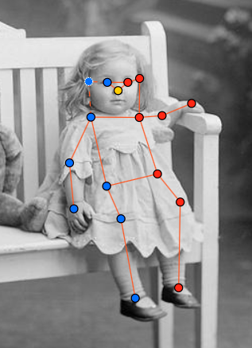
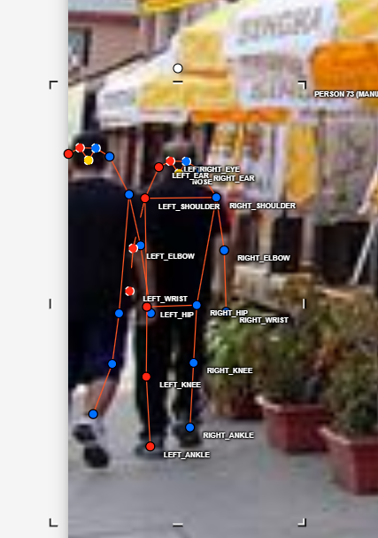
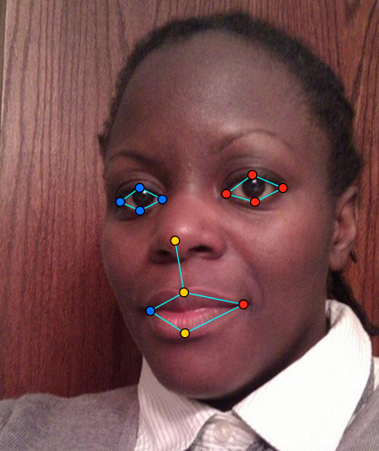

# Báo cáo cá nhân — HoVaTen-MSSV

Đổi tên file theo quy tắc `MSSV_HoTen.md`. Ví dụ: `20241234_NguyenVanAn.md`.

Dữ liệu: 12 ảnh người COCO val2017 (Lin et al., 2014) và 8 ảnh chân dung Wikimedia Commons, chỉ dùng trong lớp.

## 0. Thông tin học viên

- Họ tên: Trần Đức Kỳ
- MSSV: 2A202603277
- Email: tranducky03@gmail.com
- Link repository: https://github.com/STSGx5/K5-L2B-DAY04-TranDucKy-2A202603277-KeypointPose-Student.git
- Phiên bản CVAT (Help → About): Server version: 2.74.1
- Máy: hệ điều hành 16· RAM ___ GB · chạy CVAT chế độ đầy đủ / lite
- Bộ ảnh (`src/exports/assignment.json` do `lab.py setup` tạo): có 
- Giờ bắt đầu:
- Giờ kết thúc:

## 1. Kiểm tra label (CP0)

| Label | Kiểu | Số điểm | Tên điểm đúng bảng của lab? | Đúng thứ tự? | Số cạnh |
|---|---|---:|---|---|---:|
| `person` |Skeleton |17 |Có | Có|16 |
| `face` |Skeleton |13 |Có | Có| 13 |

Mẫu `person` dựng theo người quay mặt về camera (các điểm `left_*` nằm bên phải khung mẫu)? Có / Không
- Có nếu mẫu của bạn đặt left_* ở bên phải khung. Cảnh báo lr_swap ở bước trước cho thấy script kiểm tra đang dùng quy ước này, nên mẫu nên dựng như vậy. Bạn hãy mở mẫu để xác nhận.
Cách đổi cờ `occluded` / `outside` cho **một điểm** trên phiên bản CVAT này (một câu):
- Chọn skeleton, bấm vào điểm cần đổi rồi dùng nút Occluded Q, Outside O
...

## 2. Số lượng đã gán và thời gian (CP1, CP2)

| Nhóm ảnh | Số ảnh | Số skeleton đã gán | Số người dưới 60 px (không gán) | Số poster / gương / màn hình bỏ qua | Thời gian (phút) |
|---|---:|---:|---:|---:|---:|
| `easy` | 5 |5 | 0| | |
| `occluded` | 3 |7 |4 | | |
| `back` | 2 | 4| 2| | |
| `small` | 1 | 5| | | |
| `crowd` | 1 |3 | | | |
| `faces` | 8 | 8| — | | |

- Số ảnh người đã xong ở mốc phút 105: ___ / 10
- Thời gian thực tế (phút): CP1 ___ · CP2 ___ · CP3 ___
- Ảnh tốn thời gian nhất là ảnh nào, vì sao? - Người quay ngược lại và bị một phần vật thể che mất 

...

## 3. Bảng ca khó (CP1, CP2)

Mỗi điểm bạn phân vân một dòng, nhất là phân vân giữa `v = 1` và `v = 0`, hoặc không chắc hướng người.

| Ảnh | Người / mặt | Điểm | Cờ đã chọn | Phân vân giữa | Lý do chọn |
|---|---|---|---:|---|---|
|000000043500.jpg |Người | tay phải và khửu tay phải| V=1 | v=1 và v=0 | vì từ tư thế đứng và hành động đang làm |


## 4. Bảng tự review (CP3)

Đi từ ảnh cuối về ảnh đầu. 5 ảnh người (ít nhất 2 ảnh `back` hoặc `crowd`) và 3 ảnh mặt. Ít nhất 8 dòng, kể cả dòng `ok`. Ghi lỗi trước, sửa sau.

Mã lỗi dùng đúng một trong: `lr_swap`, `vis_flag`, `position`, `missing`, `extra`, `ok`.

| Ảnh | Người / mặt | Điểm | Mã lỗi | Ghi chú | Đã sửa? |
|---|---|---|---|---|---|
|000000167027.jpg | `person` | | left_ear | | chưa sửa|
|000000167027.jpg | person| |29 px (< 60 px). | | đã sửa |
|000000518966.jpg | person| | lr_swap| | |
| | | | | | |
| | | | | | |
| | | | | | |
| | | | | | |
| | | | | | |

Tổng hợp số lỗi theo mã:

| `lr_swap` | `vis_flag` | `position` | `missing` | `extra` | `ok` |
|---:|---:|---:|---:|---:|---:|
| | | | | | |

Điểm còn phân vân giữa `v = 1` và `v = 0` (ghi cả hai lựa chọn và lý do chọn):

- Người bị bàn che khuất và hơi bị lẹm ra ngoài: v=0 lý do là không thể xác định là chân ở đâu và có nguy cơ trân ngoài ảnh 
- 
## 5. Kiểm file xuất và kết quả tự kiểm (CP4)

Tự kiểm tay trong file JSON:

| File | Người / mặt kiểm (ảnh, thứ tự) | Số phần tử `keypoints` | Điểm `outside` ra `v = 0`, `occluded` ra `v = 1`? | `num_keypoints` khớp? |
|---|---|---:|---|---|
| `HoVaTen_persons.zip` | | | | |
| `HoVaTen_persons.zip` | | | | |
| `HoVaTen_faces.zip` | | | | |

Sau khi xuất, CVAT ghi `occluded` thành `v = ___` và `outside` thành `v = ___`. Tọa độ của điểm `outside` trong file là `0, 0` hay tọa độ cũ? ___

Hai job đã chuyển sang completed trên CVAT? Có / Không

Dán phần **TÓM TẮT** in ra từ `src/check_submission.py`:

----- TÓM TẮT (dán vào báo cáo mục 5) -----
- File person: TranDucKy_persons.zip
  Số ảnh: 12 · số skeleton `person`: 21 · mỗi annotation 51 số
  Skeleton theo ảnh: 000000043500=2, 000000072098=1, 000000167027=2, 000000205650=1, 000000213933=1, 000000311497=2, 000000314154=1, 000000375535=3, 000000381889=3, 000000518966=2, 000000558066=1, 000000580257=2
  Cờ v: v=2 275 (77%) · v=1 52 (15%) · v=0 30 (8%)
  num_keypoints trung bình: 15.6
- File face: TranDucKy_faces.zip
  Số ảnh: 8 · số skeleton `face`: 8 · mỗi annotation 39 số
  Skeleton theo ảnh: face_105668=1, face_196742=1, face_256814=1, face_261458=1, face_279764=1, face_380639=1, face_496353=1, face_79591=1
  Cờ v: v=2 96 (92%) · v=1 0 (0%) · v=0 8 (8%)
  num_keypoints trung bình: 12.0
- Ghi chú: 38 điểm v = 0 vẫn mang tọa độ cũ (CVAT 2.x xuất như vậy; chuẩn COCO ghi 0, 0). Không phải lỗi: điểm v = 0 bị bỏ qua khi huấn luyện và khi chấm.
- Số [LỖI]: 0 · số [CẢNH BÁO]: 4
Kết quả: ĐẠT (đọc lại từng cảnh báo ở trên)
```

Các `[CẢNH BÁO]` còn giữ nguyên và lý do:
  [CẢNH BÁO] 000000167027.jpg #1: `left_ear` v = 2 nằm sát mép ảnh (0, 270). Nếu khớp thật ở ngoài ảnh, bật outside thay vì kéo về mép.
  [CẢNH BÁO] 000000518966.jpg #2: thấy rõ mũi và hai mắt (v = 2) nhưng các điểm left nằm bên TRÁI ảnh, tức là gán như người quay lưng. Kiểm lại hướng người (`lr_swap` cả người?).
  [CẢNH BÁO] 000000580257.jpg #1: cặp ankle nằm ngược phía so với các cặp còn lại. Có thể đổi trái/phải một cặp (`lr_swap`), hoặc tay / chân bắt chéo thật: kiểm lại.
  [CẢNH BÁO] 000000580257.jpg #2: cặp ankle nằm ngược phía so với các cặp còn lại. Có thể đổi trái/phải một cặp (`lr_swap`), hoặc tay / chân bắt chéo thật: kiểm lại.
- vì theo ảnh là họ đanh chéo chân 
## 6. Ảnh chụp màn hình

1. Label `person` trong label constructor (đủ 17 điểm có tên):

   

2. Một người quay lưng đã gán, cờ đã đặt:

   

3. Một khuôn mặt đã gán 13 điểm, phóng to vùng mắt:

   

4. Một đoạn JSON xuất của một người:

   

Nguồn ảnh: COCO val2017 / Wikimedia Commons.

## 7. Tự đánh giá

1. Lỗi bạn mắc nhiều nhất hôm nay, và cách bạn sẽ tránh ở dự án thật:

   ...

2. Một quy tắc bạn đề xuất thêm vào guideline (kèm ảnh ví dụ nếu có):

   ...

3. Nhãn của bạn đi vào model ở đâu? Chọn một lỗi bạn đã sửa và nói nó sẽ làm model học sai thế nào (heatmap, trọng số trong loss, hay bước lật ảnh):

   ...

## 8. Khó khăn và lỗi kỹ thuật

...

## Bonus (nếu làm)

### B1 — 3 ảnh người khó thêm

| Ảnh | Số skeleton | Số người dưới 60 px | Ca khó nhất |
|---|---:|---:|---|
| | | | |
| | | | |
| | | | |

Kết quả `src/check_submission.py` cho `HoVaTen_bonus_persons.zip`:

```text
(dán ở đây)
```

### B2 — 5 ảnh khuôn mặt đen trắng / hồng ngoại

Ảnh không màu khó hơn ở điểm nào? Kính râm trên ảnh hồng ngoại có còn là `v = 1` không?

...

### B3 — Model so với nhãn của tôi (không tính điểm)

- Demo đã dùng:
- Ảnh đã thử:

1. Model có trả điểm cho khớp bị che, hay khớp ngoài ảnh không? Confidence ở các điểm đó thế nào?

   ...

2. Với người quay lưng, model có đổi trái/phải không?

   ...

3. Bộ điểm của model có giống 17 điểm COCO không?

   ...

## 9. Tài liệu tham khảo và công cụ AI đã dùng

...
